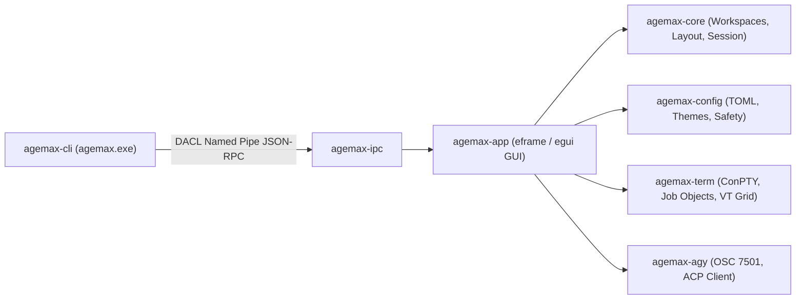

# Age Max (`agemax`)

**A native Windows terminal workspace and multi-agent mission control built in Rust.**

Age Max is designed for running, observing, and coordinating multiple Antigravity CLI (`agy`) sessions, terminal shells, and live browser previews side by side in a single high-performance desktop workstation.

> **Strict Host & Security Boundary**: Age Max contains **no embedded AI models, LLMs, or webview app shells**, and **never reads, stores, logs, or proxies user credentials or OAuth tokens**. Intelligence and authentication remain strictly inside the official CLI tools you launch.

---

## Table of Contents

- [Why Age Max?](#why-age-max)
- [Key Capabilities](#key-capabilities)
- [Architecture](#architecture)
- [Performance Budgets](#performance-budgets)
- [Getting Started](#getting-started)
- [Companion CLI (`agemax.exe`)](#companion-cli-agemaxexe)
- [Default Keyboard Shortcuts](#default-keyboard-shortcuts)
- [Configuration & Persistence](#configuration--persistence)
- [Development, Specifications & ADRs](#development--specifications--adrs)
- [License & Credits](#license--credits)

---

## Why Age Max?

Running multiple autonomous CLI agents in parallel quickly turns ordinary terminal tabs into guesswork:

- **Lost State**: You lose track of which agent is *thinking*, *running a tool*, *waiting on your approval*, or *finished*.
- **Orphaned Processes**: Closing a terminal tab on Windows can leave child processes alive and holding file locks.
- **Fragmented Context**: Browser previews, WSL distros, remote SSH hosts, and agent chats live in disconnected windows.

Age Max solves this with a native Win32/DirectX-backed (`eframe`/`egui` + `ConPTY` + `alacritty_terminal`) workstation engineered from the ground up for **Windows 10 (1809+) and Windows 11**.

---

## Key Capabilities

### Live Agent Mission Control
- **Granular Agent States**: Tracks `Idle`, `Working`, `Thinking`, `RunningTool`, `WaitingForInput`, `Done`, and `Failed` via **OSC 7501** sequences, terminal bells / OSC 9 / 99 / 777, structured **`agy acp`** stdio streams, and PTY activity bursts.
- **Animated State Borders & Procedural Mascots**: Pane borders ease smoothly over ~200 ms between state colors (subtle glow for thinking/tools, amber pulse when awaiting input, transient green flash on completion) while keeping active keyboard focus distinct. Clean-room procedural vector mascots reflect session states inside pane headers and overview cards.
- **Mission-Control Sidebar Cards**: Displays live status indicators, active working timers, rolling 16-second zero-allocation output sparklines, Git branch and background-throttled diff churn (`+N -M`), unread badges, and latest output lines.
- **All-Agents Grid View (`Grid`)**: Overview card grid across all workspaces and tabs so you can monitor parallel sessions at a glance and jump straight into any pane.
- **Global Activity Feed (`Feed`) & Attention Alerts (`Alerts`)**: Chronological milestone timeline alongside unread notifications, plus WinRT **Windows Toast notifications**, taskbar flashing (`FlashWindowEx`), and an optional **synthesized WAV attention chime** with debounce cooldown.
- **Safe Multi-Session Broadcast (`Broadcast`)**: Dispatch a prompt or command to multiple sessions only after reviewing an explicit per-pane checklist showing workspace name, backend (`Local` / `WSL` / `SSH`), and working directory.
- **Welcome & Quick-Launch View (`Home`)**: Instant access to *Start Agent*, *Safe Plan Mode* (`agy --mode plan`), *Multi-Agent Team Grid*, and recent sessions from `session.json`.

### Workspaces, Backends & Panels
- **Workspaces -> Tabs -> Binary Split Panes**: Deterministic layout tree with draggable split dividers, zoom mode, mouse-wheel scrollback, drag-selection copy/paste, right-click context menus, `Ctrl+Click` hyperlinks, and live font zoom.
- **Local ConPTY, WSL & Remote SSH**: Native PowerShell 7 / Windows PowerShell / CMD via ConPTY, plus WSL (`wsl.exe` with async distro discovery) and OpenSSH (`ssh.exe`) workspace backends.
- **Embedded WebView2 Preview Pane (`Preview`)**: Scriptable live browser pane controlled directly from the toolbar or CLI (`agemax browser open|screenshot|eval`).
- **Structured `agy acp` Card Panel (`ACP`) & Team Grid (`Team`)**: Interactive tool/artifact/plan card view over JSON-RPC stdio and one-click Coordinator + Worker split tabs.

### Safety, Privacy & Windows Hygiene
- **Independent Per-Workspace Folder Locks**: Lock any individual workspace to its own folder via a one-click pill in the folder bar, the sidebar right-click menu, or the New Workspace dialog without restricting other workspaces.
- **Optional App-Wide Safe Root Ceiling (`allowed_root_dir`)**: Configure an optional global boundary in `Settings -> Safety & Folders` that intersects with per-workspace locks to guard workspace creation, session restores (both workspace and per-pane paths), Explorer launches, and IPC requests (normalizing `..` traversal and canonical paths).
  > *Note*: Age Max folder locks govern where Age Max opens, restores, and accepts requests; they do not confine what AI agents or raw terminal shells can read or write on your filesystem.
- **Global `agy --sandbox` Toggle**: Pass `--sandbox` when launching `agy` via `enforce_agy_sandbox` in Safety settings.
- **Zero Orphaned Child Processes**: Every spawned shell and ACP child process is bound to a Windows Job Object configured with `JOB_OBJECT_LIMIT_KILL_ON_JOB_CLOSE`.
- **DACL-Secured Local IPC**: Named pipe `\\.\pipe\agemax-<username>` restricts access exclusively to the current Windows logon session / user SID and Local System.
- **Zero Telemetry**: 100% local state stored in `%APPDATA%\AgeMax\config.toml` and `%LOCALAPPDATA%\AgeMax\session.json`.

### Themes & Desktop Polish
- **6 Built-In Themes**: `Midnight Dark`, `High Contrast`, `Soft Light`, `Cyberpunk`, `Terminal Green`, and `Dracula` with live TOML hot reload.
- **Guided & Minimal Chrome Modes**: Switch between button-first *Guided Mode* (toolbar + pane headers) and distraction-free *Minimal Mode* via Settings or the Command Palette.
- **Debounced Pane Animations & Opt-In Mica**: Smooth 140 ms visual pane open/close transitions with ConPTY resize debouncing, plus an optional Windows 11 **Mica Backdrop** in Settings (falls back transparently to opaque themes on Windows 10).

---

## Architecture

Age Max is organized as a clean-room modular Cargo workspace (`MIT OR Apache-2.0`):



| Crate | Responsibility |
| :--- | :--- |
| [`agemax-core`](crates/agemax-core) | Pure domain models: `Workspace`, `Tab`, `LayoutTree`, `AgentStatus`, `NotificationStore`, `ActivityFeed`, `SessionSnapshot` |
| [`agemax-term`](crates/agemax-term) | Windows ConPTY & WSL/SSH backends, Job Objects, 4 ms coalescer, `alacritty_terminal` VT grid, git branch & diff stat helpers |
| [`agemax-agy`](crates/agemax-agy) | Official `agy` CLI adapter, OSC 7501/9/777 parser, live `agy acp` JSON-RPC client, isolated profiles, quota query |
| [`agemax-ipc`](crates/agemax-ipc) | Single-instance activation, Win32 DACL named pipe server/client, JSON-RPC 2.0 protocol |
| [`agemax-config`](crates/agemax-config) | TOML config schema, safety path guard (`validate_workspace_path`), hot-reload watcher, themes, keybindings |
| [`agemax-app`](crates/agemax-app) | Native GUI (`eframe`/`egui`), Mission Control views, procedural mascots, WebView2 pane, DWM Mica, WinRT Toasts |
| [`agemax-cli`](crates/agemax-cli) | Companion CLI (`agemax.exe`) for automating workspaces, panes, attention states, and browser previews over IPC |

---

## Performance Budgets

Age Max is built against explicit performance targets defined in [`AGENTS.md`](AGENTS.md):

| Metric | Target |
| :--- | :--- |
| Cold Start | < 300 ms from launch to first rendered frame |
| Input Latency | < 16 ms from keystroke to glyph render |
| Throughput | 10 simultaneous panes streaming dense VT output with zero dropped frames |
| Idle Footprint | < 1% CPU utilization when all panes are idle |
| PTY Coalescing | ~4 ms batching window on PTY reads to avoid per-byte repaints |

---

## Getting Started

### Prerequisites
- **OS**: Windows 10 (1809+, build 17763+) or Windows 11 (`x64`)
- **Toolchain**: [Rust stable toolchain](https://rustup.rs/) (2021 edition) with MSVC build tools
- **Optional**: [Antigravity CLI (`agy`)](https://antigravity.google/cli/install.ps1) and Microsoft Edge WebView2 Runtime (preinstalled on Windows 11)

### Build & Run from Source

```powershell
# Clone the repository (uses develop branch for active development)
git clone https://github.com/hatimbenayad/Agemax.git
cd Agemax

# Run tests, formatting, and lint checks
cargo fmt --all -- --check
cargo clippy --all-targets --all-features -- -D warnings
cargo test --workspace

# Build optimized release binaries
cargo build --release --workspace

# Launch the GUI multiplexer
.\target\release\agemax-app.exe
```

Release binaries are written to:
- `target/release/agemax-app.exe` — Native Age Max workstation GUI
- `target/release/agemax.exe` — Local IPC automation CLI

Optional Windows Explorer context menu ("Open Folder in Age Max") scripts and Inno Setup / WinGet manifests are located in [`packaging/windows/`](packaging/windows).

---

## Companion CLI (`agemax.exe`)

Control an already-running `agemax-app.exe` window over `\\.\pipe\agemax-<username>`:

```powershell
# Workspaces & layout
agemax workspace list
agemax workspace create --name "Backend" --cwd C:\Projects\api
agemax split --direction right
agemax focus <pane-uuid>

# Terminal automation & agent signaling
agemax send-keys "cargo test`r"
agemax read-screen
agemax status done --message "Tests passed"
agemax notify "Needs plan approval" --status waiting

# Focus running window on a directory (single-instance activation)
agemax activate --cwd C:\Projects\api

# Control embedded WebView2 browser preview panes
agemax browser open http://localhost:3000
agemax browser eval "document.title"
agemax browser screenshot
```

---

## Default Keyboard Shortcuts

All bindings are configurable in **Settings -> Shortcuts** or `%APPDATA%\AgeMax\config.toml`. Defaults preserve standard terminal control signals (`Ctrl+C`, `Ctrl+D`, `Ctrl+Z`, `Ctrl+K`), with an optional **`Use Ctrl+K Command Palette`** preset in Settings:

| Action | Default Shortcut |
| :--- | :--- |
| Command Palette | `Ctrl+Shift+P` |
| New Tab | `Ctrl+Shift+T` |
| Split Pane Right | `Ctrl+Shift+D` |
| Split Pane Down | `Ctrl+Shift+R` |
| Close Active Pane | `Ctrl+Shift+W` |
| Zoom / Unzoom Pane | `Ctrl+Shift+Enter` |
| Toggle Sidebar | `Ctrl+B` |
| Toggle Alerts & Feed Drawer | `Ctrl+Shift+N` |
| Jump to Oldest Waiting Agent | `Ctrl+Shift+U` |
| Copy / Paste Selection | `Ctrl+Shift+C` / `Ctrl+Shift+V` |
| Directional Pane Focus | `Alt+Arrow Keys` |
| Font Zoom | `Ctrl++` / `Ctrl+-` / `Ctrl+0` / `Ctrl+Wheel` |

---

## Configuration & Persistence

- **Global Settings**: `%APPDATA%\AgeMax\config.toml` (reloads automatically on save)
- **Project Commands**: Optional per-project `<workspace>\agemax.toml` for custom Command Palette entries
- **Session State**: `%LOCALAPPDATA%\AgeMax\session.json` (`SessionSnapshot` v1, preserving workspaces, per-workspace `locked_root`, tabs, split ratios, and `agy` conversation IDs)

Example `config.toml`:

```toml
[general]
font_size = 14.0
ui_mode = "guided"               # "guided" | "minimal"
enable_toast_notifications = true
enable_taskbar_flash = true
enable_sound_notifications = true
show_agent_mascots = true
enable_mica_backdrop = false     # Windows 11 DWM Mica opt-in
enforce_agy_sandbox = false      # Pass --sandbox when launching agy
# allowed_root_dir = "C:\\Users\\you\\Projects"
# default_workspace_dir = "C:\\Users\\you\\Projects"
```

---

## Development, Specifications & ADRs

Age Max follows clean-room, Spec-Driven Development (AI-DLC + SDD) under [`AGENTS.md`](AGENTS.md), [`specs/`](specs), and [`adr/`](adr):

- [`AGENTS.md`](AGENTS.md) — Engineering constraints, clean-room policy, and construction gates
- [`specs/00-vision.md`](specs/00-vision.md) — Product scope and non-goals
- [`specs/01-requirements.md`](specs/01-requirements.md) — Testable functional and performance requirements (`REQ-001`–`REQ-095`)
- [`specs/03-architecture.md`](specs/03-architecture.md) — Crate boundaries, ConPTY threading, and IPC flows
- [`specs/04-units/`](specs/04-units) — Unit-by-unit implementation specifications
- [`adr/`](adr) — Architecture Decision Records (`001`–`008`)

---

## License & Credits

- **Age Max**: Dual-licensed under **`MIT OR Apache-2.0`**. See [`LICENSE`](LICENSE) for details. Dependency licenses are enforced in CI via [`deny.toml`](deny.toml).
- **Icons**: Embedded vector icon font provided by [Lucide](https://lucide.dev/), licensed under the **ISC License**. See [`assets/fonts/LICENSE-LUCIDE.txt`](assets/fonts/LICENSE-LUCIDE.txt) for full terms.
