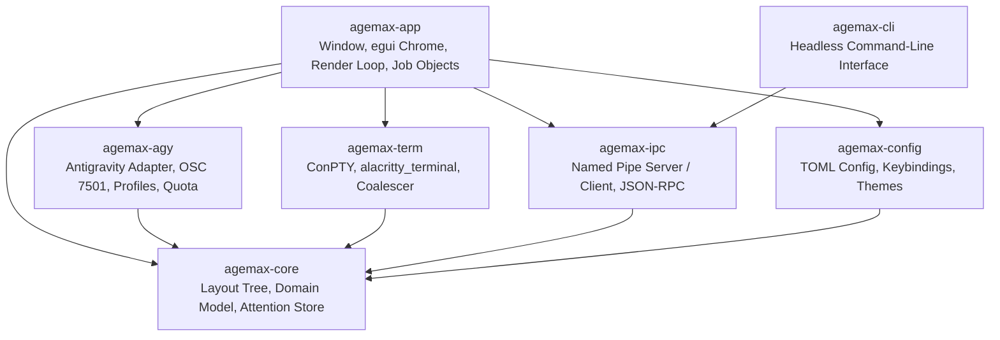
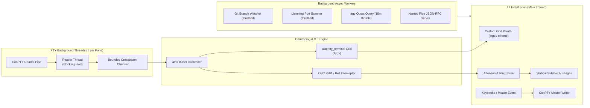
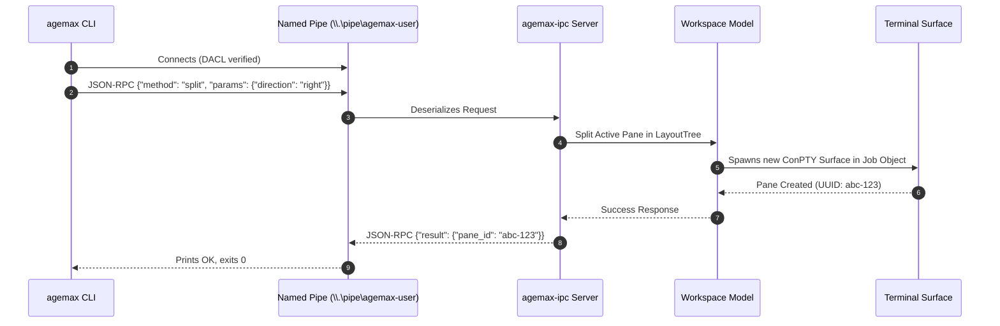

# 03 - Architecture & System Design

## 1. Overview and Crate Decomposition

Age Max is structured as a modular Cargo workspace composed of dedicated, single-responsibility crates. Business logic, terminal emulation, agent observation, and IPC protocols are isolated into platform-agnostic library crates with explicit system traits.



### Crate Responsibilities

| Crate | Responsibilities | Dependencies |
| :--- | :--- | :--- |
| `agemax-core` | Pure domain types: `Workspace`, `Tab`, `Pane`, `Surface`, `LayoutTree`, `AgentStatus`, `Notification`, `NotificationRing`. Zero OS I/O, zero GUI dependencies. | `serde`, `uuid`, `thiserror`, `proptest` (dev) |
| `agemax-term` | ConPTY process management (`portable-pty`), ANSI/VT emulation (`alacritty_terminal`), PTY buffer coalescing, scrollback search, mouse/keyboard translation. | `agemax-core`, `portable-pty`, `alacritty_terminal`, `crossbeam-channel`, `parking_lot` |
| `agemax-agy` | Antigravity CLI adapter (`AgentAdapter`), OSC 7501 parsing, hook integration, profile directory management, official quota query parsing. | `agemax-core`, `serde_json`, `directories`, `tracing` |
| `agemax-ipc` | Windows Named Pipe server and client (`\\.\pipe\agemax-<user>`), Windows DACL security, JSON-RPC 2.0 protocol types. | `agemax-core`, `tokio`, `serde_json`, `windows` (Win32 Security/Pipes) |
| `agemax-config`| TOML configuration loader (`config.toml`, `agemax.toml`), hot reloading via `notify`, theme parsing, keybinding mapper. | `agemax-core`, `toml`, `notify`, `serde` |
| `agemax-app` | Native application entrypoint, `eframe`/`egui` rendering, layout splitter, collapsible sidebar, command palette, Windows Toasts (`windows`), Job Object process containment. | All workspace crates, `windows`, `anyhow`, `tracing-subscriber` |
| `agemax-cli` | Standalone CLI client (`agemax.exe`) for scripting the multiplexer over local IPC. | `agemax-ipc`, `clap`, `tokio`, `anyhow` |

---

## 2. Threading & Concurrency Architecture

To guarantee strict compliance with performance budgets (< 16 ms input latency, < 1% idle CPU, no UI stutter), Age Max decouples heavy I/O from the render thread using a reactive, lock-free message-passing model:



### Threading Rules:
1. **Zero I/O on UI Thread**: The UI thread never performs filesystem checks, process spawning, pipe reads, or network queries.
2. **Dedicated PTY Reader Threads**: Each ConPTY surface owns a dedicated OS thread doing blocking reads from the Windows pipe.
3. **PTY Buffer Coalescer**: Output chunks are appended to a lock-free buffer. The coalescer flushes into `alacritty_terminal` on a ~4 ms timer or when 64 KB accumulates, triggering `ctx.request_repaint()`.
4. **Reactive Rendering**: When no terminal output is pending and no user input is active, the UI thread sits idle waiting for OS window messages (`0.0% CPU`).

---

## 3. Data Flow & Signal Pipelines

### A. Real-Time Agent Attention Flow

```mermaid
sequenceDiagram
    autonumber
    participant Agent as agy.exe (Child Process)
    participant ConPTY as Windows ConPTY
    participant Reader as PTY Reader Thread
    participant Coalesce as Buffer Coalescer
    participant Core as Attention Store (Core)
    participant UI as UI Render Thread
    participant WinOS as Windows OS (Toast & Taskbar)

    Agent->>ConPTY: Emits \x1b]7501;status=waiting;prompt=approval\x07
    ConPTY->>Reader: Delivers byte stream
    Reader->>Coalesce: Sends chunk via channel
    Coalesce->>Core: Parses OSC 7501 -> AgentStatus::WaitingForInput
    Core->>UI: Requests repaint (ctx.request_repaint())
    Core->>WinOS: Flashes taskbar (FlashWindowEx)
    Core->>WinOS: Shows Toast Notification ("Agent requires approval")
    UI->>UI: Renders Amber Border Ring on Pane
    UI->>UI: Updates Sidebar Workspace Badge
    WinOS-->>UI: User clicks Toast -> Focuses Pane & Workspace
    UI->>Core: Clears Attention Ring on User Input
```

### B. IPC CLI Control Flow



---

## 4. Layout Tree Specification

The Tab layout is represented as a strictly typed binary tree:

```rust
pub enum LayoutNode {
    Leaf(PaneId),
    Split {
        direction: SplitDirection, // Horizontal | Vertical
        ratio: f32,                // Split ratio (0.05 .. 0.95, default 0.5)
        first: Box<LayoutNode>,
        second: Box<LayoutNode>,
    },
}
```

### Tree Invariants (Enforced via Property-Based Tests):
1. Every `Leaf` contains a unique, non-null `PaneId`.
2. Every `Split` node has valid `0.05 <= ratio <= 0.95`.
3. Closing a leaf collapses its parent split node into the sibling node.
4. Total screen bounding rectangle (`Rect`) is partitioned with zero overlap and zero gaps between split children.
5. Zooming a pane sets an active zoom override pointer without mutating the underlying tree geometry, allowing zero-loss un-zooming.

---

## 5. Security & Isolation Architecture

1. **Named Pipe DACL**:
   - Security Descriptor created with an explicit DACL granting `FILE_ALL_ACCESS` to the token owner SID (`TOKEN_OWNER`) and `SYSTEM`.
   - Rejects remote network connections and tokens from other user sessions.
2. **Windows Job Objects**:
   - Every spawned process is placed in a Windows Job Object configured with:
     ```rust
     info.LimitFlags = JOB_OBJECT_LIMIT_KILL_ON_JOB_CLOSE;
     ```
   - Guarantees 100% cascade cleanup of child and grandchild processes when a pane or the app closes.
3. **Zero Credential Access**:
   - Age Max processes have zero credential-reading code.
   - All token storage, keyring calls, and Google OAuth handshakes remain inside the official `agy.exe` process.
